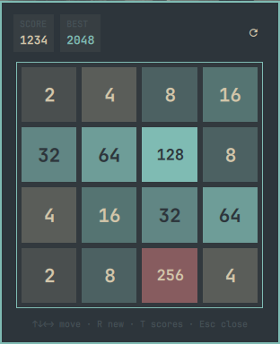

# 2048

The classic 2048 sliding-tile game in a keyboard-driven, theme-aware Omarchy bar panel.



## Features

- Classic 4×4 sliding-tile game with the standard merge rules.
- Tiles slide between cells and merged tiles pop; a `+N` indicator floats up on merges.
- Theme-aware palette with automatic text contrast — every color comes from the active Omarchy theme, and the tile text color is chosen by WCAG contrast (no hard-coded colors).
- Score and best-score cards in the panel header.
- A local top-10 leaderboard of your own finished games.
- Keyboard-first: play without leaving the bar.
- The board, best score and leaderboard persist across panel closes, shell restarts and reboots.

## Install

```sh
omarchy plugin add https://github.com/pwn27sbx/omarchy-2048.git --enable
```

## Controls

| Key | Action |
|---|---|
| Arrow keys / `H` `J` `K` `L` / `W` `A` `S` `D` | Move tiles |
| `R` | New game |
| `T` | Top scores |
| `Enter` / `Space` | Keep going after 2048; new game after game over |
| `Esc` | Close the panel; in the scores view, go back to the board |
| `Tab` | Switch to the neighbouring bar panel |

Clicking the board returns keyboard focus to it.

## Optional keybinding

To open the panel from anywhere, add a keybinding to your Hyprland Lua config. This is an example — the plugin does not add it for you:

```lua
o.bind("SUPER + ALT + 2", "2048", "omarchy-shell pwnsxb.2048 toggle")
```

## Data and privacy

- The board, best score and leaderboard are stored in `$HOME/.local/state/pwnsxb-2048/state.json` (XDG state).
- The leaderboard is local only: it keeps the top 10 of your own finished games, lives in that same file, and is reset by deleting that file.
- No network access, no accounts, no shell commands.
- If the state file is corrupt or unreadable, the game starts a new game and the best score restarts at 0.

## Development

```sh
node tests/run-model-tests.js
omarchy plugin validate .
/usr/lib/qt6/bin/qmllint -I /usr/share/omarchy/shell BarWidget.qml Panel.qml
```

## Removal

```sh
omarchy plugin remove pwnsxb.2048 --yes
rm -rf "$HOME/.local/state/pwnsxb-2048"
```

## License

MIT — see [LICENSE](LICENSE).
