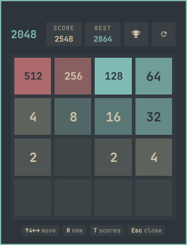
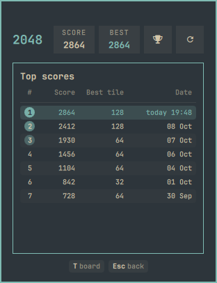
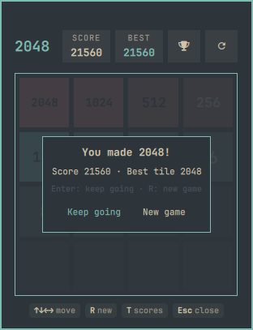
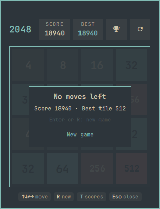

# 2048

The classic 2048 sliding-tile game in a keyboard-driven, theme-aware Omarchy bar panel.


## Screenshots

| Board | Top scores |
|:---:|:---:|
|  |  |
|  |  |

## Features

- Classic sliding-tile game with the standard merge rules, on boards from **3×3 to 8×8** (3, 4, 5, 6 and 8) — each size keeps its own saved game, best score and top-10 leaderboard.
- **Undo** the last 50 moves with `U` or `Ctrl+Z`. Undo also lifts you out of a game over or the win card. A game that used undo is marked `assisted` and never enters the leaderboard.
- Tiles slide between cells and merged tiles pop; a `+N` indicator floats up on merges, and the score counts up instead of jumping.
- Theme-aware palette with automatic text contrast — every color comes from the active Omarchy theme, and the tile text color is chosen by WCAG contrast (no hard-coded colors).
- Header with score and best-score cards; beating your best briefly highlights the BEST card.
- A local top-10 leaderboard of your own finished games, with medal ranks, a highlighted latest entry and per-entry dates.
- Play with the keyboard, the mouse or a touchpad: drag/swipe the board to move, and click the buttons in the win or game-over card.
- A key-chip footer always shows the available shortcuts for the current view.
- The board, best score and leaderboard persist across panel closes, shell restarts and reboots.

## Install

```sh
omarchy plugin add https://github.com/pwn27sbx/2048.git --enable
```

## Requirements

- `python3` — preinstalled on Omarchy.
- `timeout` — part of coreutils, preinstalled on Omarchy.

No other dependencies.

## Controls

| Key / input | Action |
|---|---|
| Arrow keys / `H` `J` `K` `L` / `W` `A` `S` `D` | Move tiles |
| Drag or swipe on the board | Move tiles (mouse / touchpad) |
| `U` or `Ctrl+Z` | Undo the last move |
| `[` / `]` or click the size badge | Switch board size (3×3 – 8×8) |
| `R` | New game |
| `T` | Top scores |
| `Enter` / `Space` | Keep going after 2048; new game after game over |
| `Esc` | Close the panel; in the scores view, go back to the board |
| `Tab` | Switch to the neighbouring bar panel |
| Click the card buttons | Keep going / New game in the win or game-over card |

Clicking or tapping the board returns keyboard focus to it; a click with no drag only restores focus, and drags are ignored while the scores view or an overlay is open. The footer shows these keys as chips for the current view.

## Optional keybinding

To open the panel from anywhere, add a keybinding to your Hyprland Lua config. This is an example — the plugin does not add it for you:

```lua
o.bind("SUPER + ALT + 2", "2048", "omarchy-shell pwnsxb.2048 toggle")
```

## Data and privacy

- The board, best score and leaderboard live in `${XDG_STATE_HOME}/pwnsxb-2048/state.json` (default `~/.local/state/pwnsxb-2048/state.json`). `XDG_STATE_HOME` is used only when it is an absolute path; otherwise the default applies.
- The panel runs one bundled Python helper (`helpers/state_io.py`) with fixed arguments for every state read and write: no shell, no network, no account. The helper stores an owner-only `0600` file, reads at most 64 KiB, and follows no symlinks.
- The leaderboard is local only: it keeps the top 10 of your own finished games, lives in that same file, and is reset by deleting that file.
- If the state file is corrupt, oversized or unreadable, the game starts a new game and the best score restarts at 0.

## Development

```sh
node tests/run-model-tests.js
python3 -m unittest discover -s tests -v
omarchy plugin validate .
/usr/lib/qt6/bin/qmllint -I /usr/share/omarchy/shell BarWidget.qml Panel.qml
```

## Removal

```sh
omarchy plugin remove pwnsxb.2048 --yes
rm -rf "${XDG_STATE_HOME:-$HOME/.local/state}/pwnsxb-2048"
```

## License

MIT — see [LICENSE](LICENSE).
