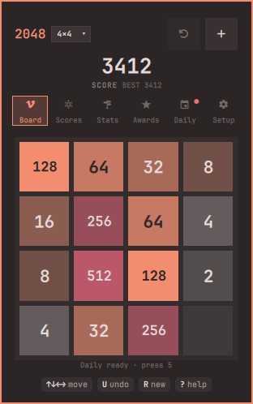
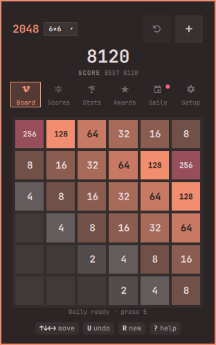
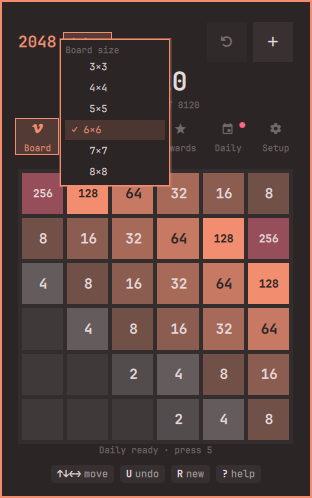
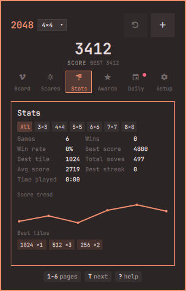
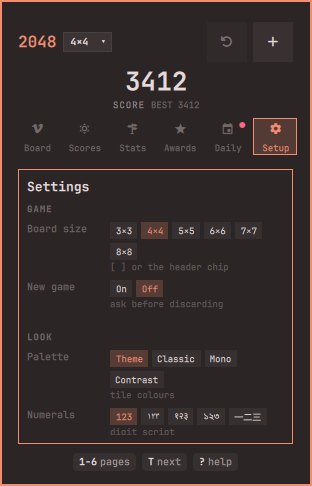
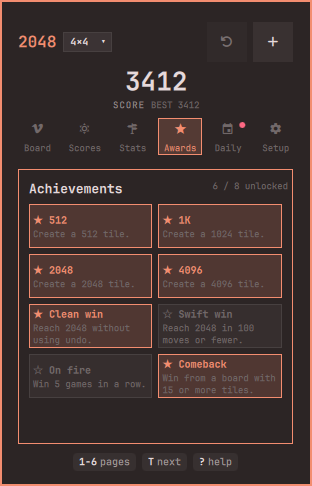
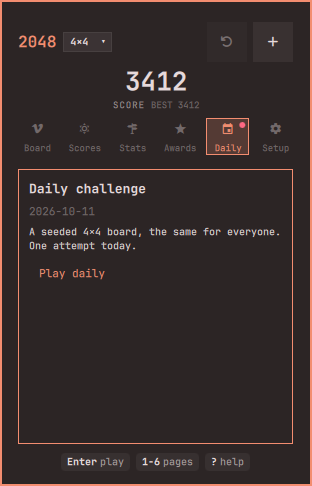

# 2048

The classic 2048 sliding-tile game in a keyboard-driven, theme-aware Omarchy bar panel — with undo, six board sizes, stats, achievements and a daily challenge. Navigation lives in a visible six-tab bar, and the header puts the live score first.


## Screenshots

| Board (4×4) | Board (6×6) | Size picker | Scores |
|:---:|:---:|:---:|:---:|
|  |  |  |  |
| **Stats** | **Settings** | **Achievements** | **Daily challenge** |
|  |  |  |  |

## Features

**Game**
- Boards from **3×3 to 8×8** (3, 4, 5, 6, 7 and 8). Each size keeps its own saved game, best score and top-10 leaderboard; switch with `[` / `]`, the header size chip (its inline picker), or the settings page.
- **Undo** the last 50 moves (`U` / `Ctrl+Z`), including out of a game over or the win card. A game that used undo is marked *assisted* and never enters the leaderboard.
- Slide/pop animation, a `+N` gain indicator, a score count-up, invalid-move shake, big-merge glow rings (128+ and stronger at 1024+), a combo badge for streaks, and confetti on 2048/4096.
- **Optional sound** (off by default): a merge blip whose pitch rises with the tile.
- Play with the keyboard, mouse or touchpad (drag/swipe), and a full keyboard help overlay on `?`.

**Progress**
- **Stats** per size and overall: games, wins, win rate, best score, best tile, total moves, average score, longest streak, time played, a **score trend** over your recent games and a **best-tile breakdown** as labelled chips.
- **Achievements** (a badge grid with unlock toasts): first 512/1024/2048/4096, a win without undo, a win in ≤100 moves, a 5-win streak, and a comeback from a crowded board.
- **Daily challenge**: the same date-seeded board for everyone, one attempt a day, its own history, and share text copied to the clipboard.

**Look and feel**
- Theme-native by default: every colour comes from the active Omarchy theme, and tile text is chosen by WCAG contrast. Optional **classic 2048**, **mono** and **high-contrast** palettes.
- **Numerals** in five scripts (Western, Arabic-Indic, Devanagari, Bengali, CJK) on tiles and scores.
- **Window scale** 90–150 %, a `motion` setting (full / reduced / off) that gates every animation (including the page fade), and a short per-page footer.

### Navigation

- A **visible six-tab bar** — Board · Scores · Stats · Awards · Daily · Setup — reachable by click, `1`–`6`, or `T` / `Shift+T`. The active tab is highlighted, and a small dot marks news (a daily ready to play, or an unseen badge).
- The **header is score-first**: the live score is the hero, best is a small secondary, the board-size chip opens an **inline picker**, and undo / new game are grouped on the right.
- **Settings** is grouped into Game · Look · Sound & motion · Advanced; **Reset stats** lives under Advanced behind a confirm prompt (stats and badges are cleared, bests and leaderboards are kept).
- `?` opens the **full keyboard help** as an overlay; footers stay short and per page. Settings and Help scroll with the arrow keys or `j` / `k`.

### Compared with a typical 2048 plugin

| | Typical 2048 plugin | This plugin |
|---|:---:|:---:|
| Classic sliding-tile game + keyboard | ✓ | ✓ |
| Theme-aware colours, auto text contrast | sometimes | ✓ |
| Persisted board, best, leaderboard | sometimes | ✓ |
| Multiple board sizes (3×3 – 8×8) | sometimes | ✓ |
| Undo | sometimes | ✓ (50 moves, assisted flag) |
| Stats page with a score trend + tile breakdown | rare | ✓ |
| Achievements | rare | ✓ |
| Daily challenge (seeded) | rare | ✓ |
| High-contrast palette | rare | ✓ |
| Numerals in multiple scripts | rare | ✓ |
| Sound, motion setting | sometimes | ✓ (off by default) |
| Multi-monitor sync | rare | ✓ |

## Install

```sh
omarchy plugin add https://github.com/pwn27sbx/2048.git --enable
```

## Requirements

- `python3` — preinstalled on Omarchy (the state helper).
- `timeout` — part of coreutils, preinstalled on Omarchy.
- `pw-play` (PipeWire) — only if you enable sound; `wl-copy` (wl-clipboard) — only for the daily share button.

No other dependencies. The plugin itself bundles no runtime beyond these.

## Controls

| Key / input | Action |
|---|---|
| Arrow keys / `H` `J` `K` `L` / `W` `A` `S` `D` | Move tiles (arrows / `j` `k` scroll on Settings and Help) |
| Drag or swipe on the board | Move tiles (mouse / touchpad) |
| `U` or `Ctrl+Z` | Undo the last move |
| `[` / `]` or the header size chip | Switch board size (3×3 – 8×8); the chip opens an inline picker |
| `1` … `6` | Jump to a tab: Board · Scores · Stats · Awards · Daily · Setup |
| `T` / `Shift+T` | Next / previous tab |
| `R` | New game (a confirm prompt if the setting is on) |
| `?` | Keyboard help (full key list) |
| `Enter` / `Space` | Keep going after 2048; new game after game over; play the daily |
| `Esc` | Back a page, leave the daily, or close the panel |
| `Tab` | Switch to the neighbouring bar panel |

Clicking the board returns keyboard focus to it; a click with no drag only restores focus. The footer shows the keys for the current page.

## Optional keybinding

To open the panel from anywhere, add a keybinding to your Hyprland Lua config. This is an example — the plugin does not add it for you:

```lua
o.bind("SUPER + ALT + 2", "2048", "omarchy-shell pwnsxb.2048 toggle")
o.bind("SUPER + ALT + P", "2048 stats", "omarchy-shell pwnsxb.2048 page stats")
```

`omarchy-shell pwnsxb.2048 page <name>` opens any page from a script or keybinding (`scores`, `stats`, `achievements`, `daily`, `settings`, `help`).

## Data and privacy

- All game data (per-size games, bests, leaderboard, stats, achievements, daily history) lives in one file: `${XDG_STATE_HOME}/pwnsxb-2048/state.json` (default `~/.local/state/pwnsxb-2048/state.json`). `XDG_STATE_HOME` is used only when it is an absolute path.
- Every read and write goes through one bundled Python helper (`helpers/state_io.py`) with fixed arguments — no shell, no network, no account. The helper opens the state directory and file with `O_NOFOLLOW` and checks they are owned by you, reads at most **64 KiB**, and writes atomically: an owner-only `0600` temp file, `fsync`, then `os.replace`, then a directory `fsync`.
- The only other processes are fixed-argument helpers: `pw-play` (a bundled WAV, only if sound is on) and `wl-copy` (the daily share text). Neither takes a path or text from anywhere but this plugin's own bundle/state.
- The leaderboard and stats are local only and reset by deleting that file.
- If the state file is corrupt, oversized or unreadable, the game starts a new game and the best score restarts at 0.

## Credits

- Tiles, layout, code and artwork are original to this plugin (MIT).
- `assets/merge.wav` is an original short blip generated for this plugin (synthesized offline; no third-party sample), so the whole plugin is MIT-clean.

## Development

```sh
node tests/run-model-tests.js
python3 -m unittest discover -s tests -v
omarchy plugin validate .
/usr/lib/qt6/bin/qmllint -I /usr/share/omarchy/shell BarWidget.qml Panel.qml
```

## Removal

```sh
omarchy plugin remove pwnsxb.2048 --yes
rm -rf "${XDG_STATE_HOME:-$HOME/.local/state}/pwnsxb-2048"
```

## License

MIT — see [LICENSE](LICENSE).
